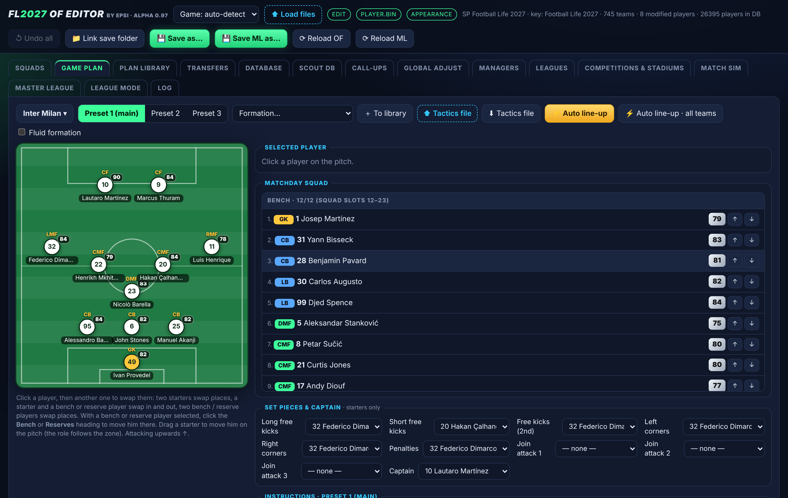
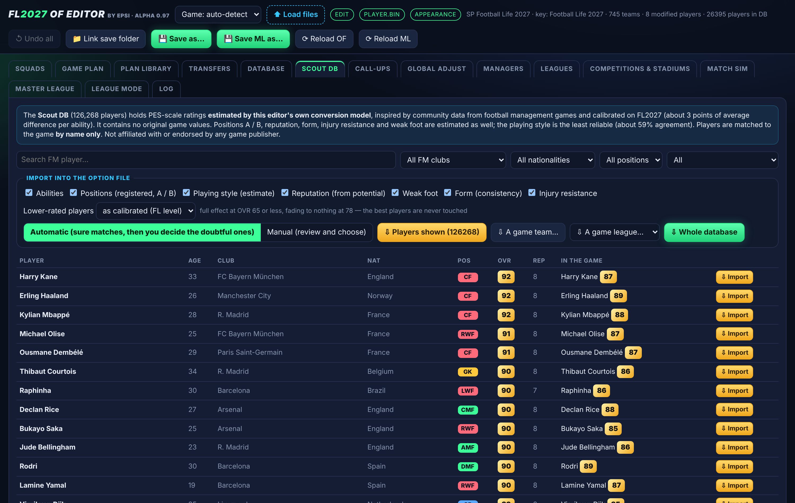
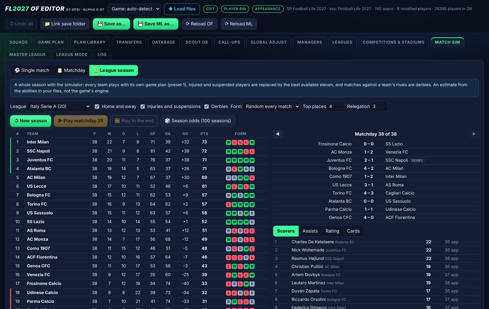
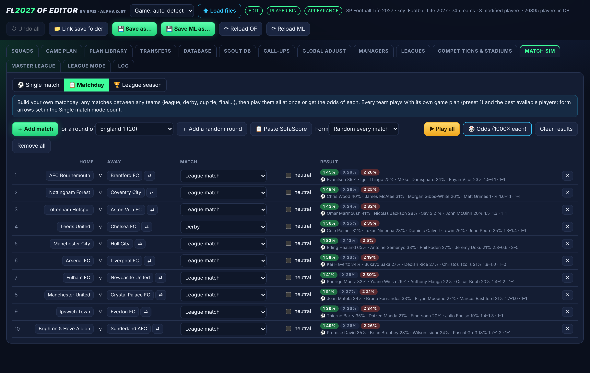
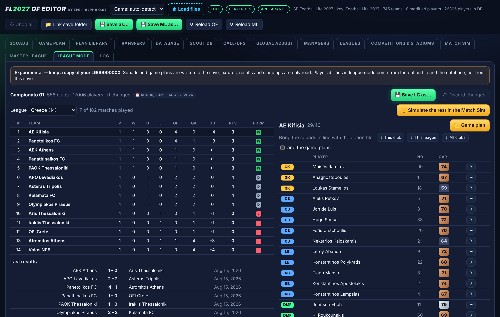
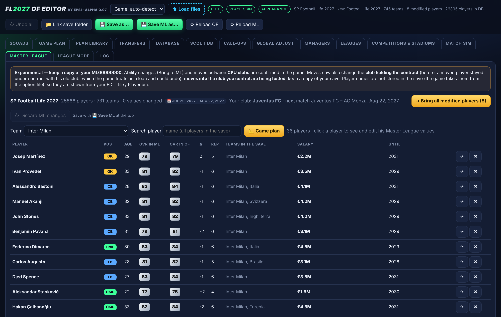
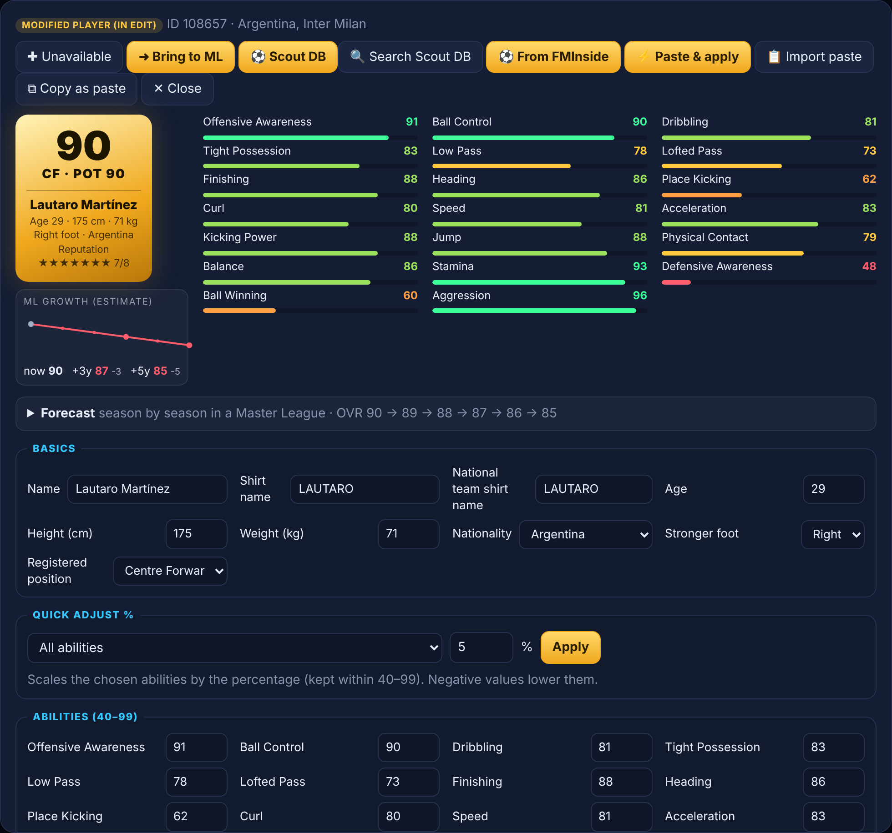

# FL2027 OF Editor By Epsi

**A standalone editor for the option file (EDIT00000000), Master League and League mode saves of SP Football Life 2027 and PES 2021.**
One Windows exe, no installation, no decrypt / encrypt step: the files are opened and written directly, and every save is re-opened and checked.

**[⬇ Download the latest version](../../releases/latest)** · [Changelog](CHANGELOG.md) · [Full manual](docs/MANUAL.md)

> Status: **alpha**. File handling is solid, but some features still need confirming in the game. **Always keep a copy of your EDIT / ML / LG files.**

## What it does

- **Squads, transfers, call-ups, leagues, managers, stadiums and competitions** of the option file.
- **Game Plan** on a virtual pitch: formations, 34 historical game plans, team instructions, set-piece takers, auto line-up (one team or all), two clicks to swap any two players.
- **Player editor** with abilities, positions on a clickable map (A / B / C), skills, styles, forecast and potential.
- **Scout DB**: about 126,000 players with PES-scale ratings estimated by the editor's own conversion model; import a player, a team, a league or everything, matched on age, club, role, nationality and name.
- **Match Sim**: single matches (minute by minute or 1000×, with the most likely scorers), your own matchday, or a whole **league season** with standings, scorers, injuries and 100-season odds.
- **Master League** saves: abilities, positions, contracts, transfers and exchanges (within the game's limit of 40 players under contract, loans included), game plans of every club, career dates.
- **League mode** saves: standings, squads synced with your option file, game plans, and the rest of the season simulated from the real table.

| | |
|---|---|
|  |  |
|  |  |
|  |  |

## How to use

1. Download the zip from **[Releases](../../releases/latest)** and run the exe (Windows may show a SmartScreen warning the first time: *More info → Run anyway*; the exe is not code-signed).
2. Click **Load files** and select `EDIT00000000` with `Player.bin` and `PlayerAppearance.bin` from the patch database. Add `ML00000000` for a Master League career or `LG00000000` for League mode.
3. Edit. Every change is listed in the **Log** tab; **Undo all** takes everything back until you save.
4. **Save** (or link the save folder and overwrite directly, with a backup of the previous file).

## Good to know

- **Scout DB ratings are estimates**, on one power scale for every league: the four top leagues come out close to FL's own level, smaller leagues stricter. Import whole leagues rather than single players.
- **OVR, potential, forecast, Match Sim and League season are the editor's estimates**, not game values.
- Master League game plans and League mode are **experimental**: tell me what you see in the game.

## Credits

- Save encryption algorithm: pesXdecrypter (the4chancup, public domain).
- EDIT file layout: based on 4ccEditor (the4chancup).
- .PES2021_tactics format: nkei.
- SP Football Life by the SmokePatch team.

This tool is **unofficial** and not affiliated with or endorsed by the SmokePatch team, Konami or any other game publisher. All trademarks belong to their owners. The Scout DB contains no original game values.

By Epsi
